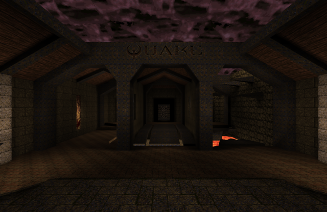

# retro-vkquake

A simple Quake map viewer using Vulkan.



## Prerequisites

To build retro-vkquake, you must first install the following tools:

- [Meson](https://mesonbuild.com/)
- [GCC](https://gcc.gnu.org/) or [Clang](https://clang.llvm.org/)
- [Ninja](https://ninja-build.org/)
- [SDL3](https://www.libsdl.org/)
- [Vulkan](https://www.vulkan.org/) (loader + headers; on macOS a Vulkan driver: [KosmicKrisp](https://docs.mesa3d.org/drivers/kosmickrisp.html) or [MoltenVK](https://github.com/KhronosGroup/MoltenVK))
- [glslang](https://github.com/KhronosGroup/glslang) (provides `glslangValidator` to compile the shaders)

### Install dependencies

#### openSUSE

`$ sudo zypper install meson ninja gcc-c++ SDL3-devel vulkan-devel glslang-devel`

#### Ubuntu

`$ sudo apt install meson ninja-build g++ libsdl3-dev libvulkan-dev glslang-tools`

#### macOS

`$ brew install meson ninja pkg-config sdl3 vulkan-loader vulkan-headers molten-vk glslang`

##### KosmicKrisp (recommended on Apple silicon, macOS 26 or later)

[KosmicKrisp](https://docs.mesa3d.org/drivers/kosmickrisp.html) is Mesa's conformant Vulkan 1.4 driver on top of Metal, and Khronos now recommends it over MoltenVK. Homebrew's `mesa` package includes it:

`$ brew install mesa`

Homebrew installs the driver manifest in `$(brew --prefix)/share/vulkan/icd.d`, which the Vulkan loader does not search. Make it visible with a symlink in your user ICD directory:

```
$ mkdir -p ~/.config/vulkan/icd.d
$ ln -sf "$(brew --prefix)/share/vulkan/icd.d/kosmickrisp_mesa_icd.aarch64.json" ~/.config/vulkan/icd.d/
```

`vulkaninfo --summary` should now list both MoltenVK and KosmicKrisp. When both are installed, quake prefers KosmicKrisp and prints the chosen device at startup. Without KosmicKrisp, it falls back to MoltenVK (required on Intel Macs and macOS releases before 26).

To force a specific driver, point `VK_DRIVER_FILES` at its manifest:

```
$ VK_DRIVER_FILES="$(brew --prefix)/etc/vulkan/icd.d/MoltenVK_icd.json" ./build/quake
```

## Build instructions

To build the quake demo program, run:

```
$ meson setup build
$ meson compile -C build
```

The `build` directory will contain the demo program.

## Usage

```
Usage: quake [OPTION]...

Options:
 -h, --help         Display this text and exit
 -w, --window       Render in a window
     --fullwindow   Render in a fullscreen window
 -f, --fullscreen   Render in fullscreen
 -v, --vsync        Enable sync to vertical refresh
     --novsync      Disable sync to vertical refresh
 -c, --showcursor   Show mouse cursor
     --nocursor     Hide mouse cursor
     --showfps      Show frame rate in window title
     --nofps        Hide frame rate
     --capfps=VALUE Limit frame rate to the specified VALUE
```

## License

Licensed under MIT license. See [LICENSE](LICENSE) for more information.

## Authors

* Johan Gardhage
